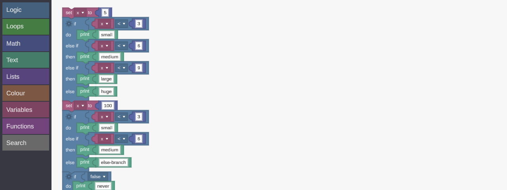

# Blockly for Unity

A native C# port of [Blockly](https://developers.google.com/blockly) for Unity 6. It loads Blockly programs (JSON and legacy XML), draws the blocks with UGUI and TextMeshPro, lets the user edit them, and runs them with a built-in interpreter. There is no WebView: the same code runs on Windows, macOS, iOS, Android and WebGL.

| Classic | Dark | Purple skin |
|---|---|---|
|  |  |  |

## Features

- Blocks, inputs, fields, shadows, mutators, variables and procedures; Blockly JSON and XML in and out.
- An interpreter for the standard blocks with Run, Step, Stop, slow mode and a highlighted current block.
- A full editor: toolbox and flyouts, drag and snap, field editing, undo / redo, copy / paste, multi-select, workspace notes, block warnings, zoom, a File menu.
- Themes (Classic, Dark, High Contrast and your own) and your own blocks from JSON definitions plus C# handlers.
- Code export (JavaScript, Python and more) and a plain .NET core (`Blockly.Core`) that runs without Unity.

## Quick start

1. Unity 6 (6000.0 or newer). Add the package from git (Window > Package Manager > + > Add package from git URL):

   ```
   https://github.com/kirillrybin/b4u.git?path=/Packages/com.b4u.blockly
   ```

2. Import the TextMeshPro essentials once: **Blockly > Setup > Import TMP Essentials**.
3. Build the demo: **Blockly > Create Playground Scene**, press Play, pick a program, press Run.
4. Use it from code:

   ```csharp
   Workspace ws = StandardBlockSet.Load(programText);   // Blockly JSON or XML
   var interpreter = new Interpreter(ws) { Print = Debug.Log };
   interpreter.Start();
   interpreter.RunToCompletion();
   ```

The full guide (your own blocks, themes, languages, saving, platforms, known limits) is in [the package README](Packages/com.b4u.blockly/README.md).

## Skins

`main` is the customizable package and carries no particular look. The Purple skin (a theme, category icons, Poppins font) lives on the [`skin/purple`](../../tree/skin/purple) branch and as the **Purple skin** sample of the package.

## Tests

`dotnet test dev/Core.Tests` runs the platform-independent tests; the Unity tests run from **Window > General > Test Runner** (EditMode).

## License

MIT, see [LICENSE](LICENSE). The standard block definitions come from [Blockly](https://github.com/google/blockly) by Google (Apache 2.0); fonts and pictures are listed in [NOTICE](Packages/com.b4u.blockly/NOTICE.md).
